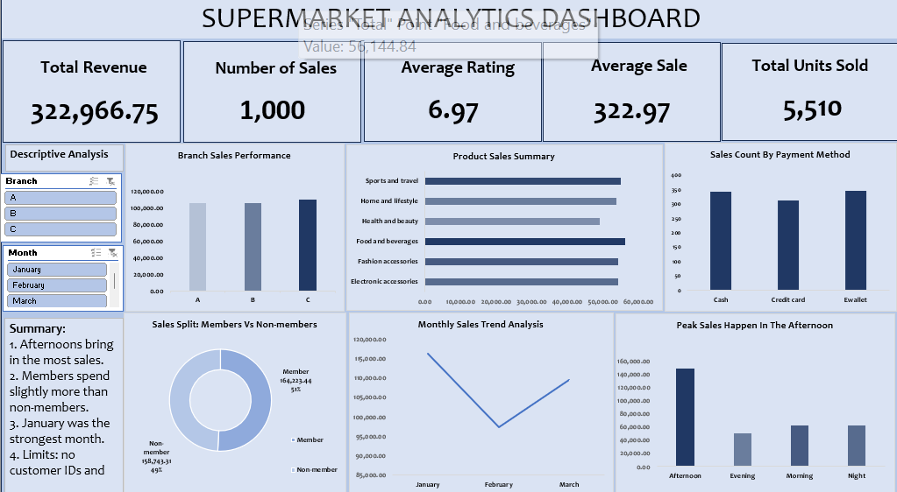

# Supermarket Sales Analysis Dashboard (Excel)

An Excel dashboard that answers one question: **where and when does a three-branch supermarket make the most money, and what keeps customers happy?**

## Data
1,000 sales from three branches (A, B, C), January to March 2019. Each row is one sale with product line, quantity, unit price, tax, payment method, customer type, time and customer rating.

## What I did
- Checked for blanks and duplicates, fixed a hidden space in a column header
- Relabelled codes (Member / Non-member)
- Added Month, Time Slot and Rating Group columns
- Built pivot tables, 6 charts and 5 KPI cards linked to Branch and Month slicers

## Key findings
1. Afternoons bring in about 46% of revenue
2. The three branches are within about 4% of each other
3. Members spend slightly more than non-members (51% vs 49% of sales)
4. January was the strongest month
5. Product lines and payment methods are fairly evenly split

## Limits
- No customer IDs, so sales are counted, not customers
- No real cost data, so profit cannot be measured
- Only three months of data

## Files
- `Supermarket_Sales_Dashboard.xlsx` the Excel workbook
- `Supermarket_Sales_Project_Summary.pdf` the full write-up
- `dashboard.png` screenshot of the dashboard

## Tools
Microsoft Excel (Tables, PivotTables, slicers, formulas)
